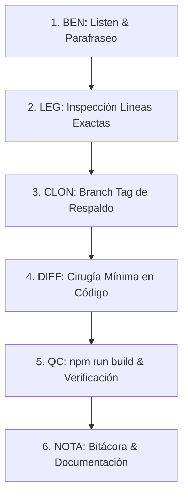

# 🎄 Plan de Desarrollo: Trancheado de Inversionistas para Regalos de Navidad

> **Módulo:** Herramientas — Estado de Posición & Auditoría (`#herramientas_estado_posicion`)  
> **Archivo Destino:** `src/features/herramientas/EstadoPosicionPage.tsx`  
> **Servicio de Datos:** `src/services/estadoPosicionService.ts`  
> **Generador Excel:** `src/utils/excelGeneratorTrancheadoNavidad.ts`  
> **Fecha de Elaboración:** Octubre 2026  
> **Estado:** Propuesta de Plan & Especificación Técnica  

---

## 1. 🎯 Resumen Ejecutivo y Objetivo de Negocio

El área de gestión patrimonial de **InAndes** requiere clasificar (*tranching*) a los inversionistas de acuerdo con el volumen total de su posición consolidada (en Soles y en Dólares) para la campaña de **Regalos de Navidad**.

Para ello, se implementará en la interfaz de **Estado de Posición** (`#herramientas_estado_posicion`):
1. **Control de Tipo de Cambio (T.C.):** Una ventana/caja de texto interactiva ubicada junto al buscador para que el usuario ingrese la tasa de conversión (valor sugerido por defecto: `3.40`).
2. **Botón Burbuja "Descargar Excel":** Un botón de acción rápida al lado del Tipo de Cambio para exportar la matriz consolidada.
3. **Respeto a Filtros Activos:**
   - Si está seleccionado **TODOS**, exporta la totalidad de partícipes principales.
   - Si está seleccionada una letra del Rolodex (**A, B, C...**), exporta únicamente los inversionistas de dicha letra.
   - Si hay una búsqueda activa en el OmniBuscador, exporta el subconjunto filtrado.
4. **Matriz Consolidada con 5 Columnas Fundamentales:**
   - **Partícipe Principal:** Nombre del inversionista titular (`id_inversionista_1`), ordenado alfabéticamente (A-Z).
   - **Total Posición Soles (PEN):** Suma del capital vigente de contratos/certificados en Soles.
   - **Total Posición Dólares (USD):** Suma del capital vigente de contratos/certificados en Dólares.
   - **Consolidado Soles (PEN):** $\text{PEN} + (\text{USD} \times \text{TC})$.
   - **Consolidado Dólares (USD):** $\text{USD} + (\text{PEN} / \text{TC})$.

---

## 2. 📊 Arquitectura de Datos y Reglas Financieras

### 2.1 Identificación del Partícipe Principal
En el modelo CRM de InAndes (`crm_contratos`), cada contrato de inversión cuenta con hasta 4 inversionistas cotitulares:
- `id_inversionista_1`: **Partícipe Principal (Titular del Contrato y Certificado)**.
- `id_inversionista_2`, `id_inversionista_3`, `id_inversionista_4`: Cotitulares secundarios.

> **Regla de Negocio:** El reporte agrupará y totalizará la posición asignándola al **Partícipe Principal** (`id_inversionista_1`), evitando duplicidad de saldos entre cotitulares y reflejando con exactitud la cabeza de grupo familiar/patrimonial para la entrega de regalos.

### 2.2 Determinación del Saldo de Capital
Para cada contrato asignado al partícipe:
- Se consulta el saldo de capital vigente más reciente en `crm_certificados_eventos` (`capital_final_saldo`).
- En ausencia de eventos posteriores de amortización/capitalización, se toma el `monto_inversion` original de `crm_contratos`.
- Se segregan los saldos por moneda: `moneda === 'PEN'` vs `moneda === 'USD'`.

### 2.3 Fórmulas de Consolidación Multidivisa
Dado un Tipo de Cambio $TC > 0$ ingresado por el usuario:
$$\text{Consolidado}_{\text{PEN}} = \text{Saldo}_{\text{PEN}} + (\text{Saldo}_{\text{USD}} \times TC)$$
$$\text{Consolidado}_{\text{USD}} = \text{Saldo}_{\text{USD}} + \left(\frac{\text{Saldo}_{\text{PEN}}}{TC}\right)$$

---

## 3. 🎨 Diseño de Interfaz de Usuario (UI/UX)

La barra de herramientas superior en `EstadoPosicionPage.tsx` actualmente aloja el **OmniBuscador** a la izquierda y el **Rolodex A-Z** a la derecha. Se integrarán los nuevos controles respetando la estética Glassmorphism corporativa de InAndes:

```
┌────────────────────────────────────────────────────────────────────────────────────────────────────────┐
│ [🔍 Buscar DNI, Nombre...]  │ [💱 T.C.: 3.75]  │ [📊 Descargar Excel]  │  [TODOS] [A] [B] [C] ... [#]  │
└────────────────────────────────────────────────────────────────────────────────────────────────────────┘
```

### 3.1 Especificaciones Visuales de los Nuevos Controles:
1. **Input Tipo de Cambio:**
   - Contenedor con borde suave, fondo blanco / `dark:bg-slate-950`, bordes redondeados `rounded-xl`.
   - Etiqueta o prefijo visual: `T.C.` con icono de divisas o moneda.
   - Valor inicial sugerido: `3.40` (editable por el usuario, validación numérica positiva).
   - Dimensiones compactas para coexistir limpiamente en la misma fila en desktop.

2. **Botón Burbuja "Descargar Excel":**
   - Estilo píldora/burbuja corporativa `rounded-xl font-bold text-xs`.
   - Paleta de color: Verde esmeralda corporativo (`bg-emerald-600 hover:bg-emerald-700 text-white shadow-sm shadow-emerald-600/30`) con icono `FileSpreadsheet` o `Download` de `lucide-react`.
   - Estado de carga animado (`RefreshCw` rotatorio) mientras se prepara y compila la matriz Excel.

---

## 4. 📑 Estructura del Archivo Excel Generado (.xlsx)

El archivo será generado utilizando `exceljs` para garantizar un formato visual de alta dirección (encabezados con color institucional InAndes, bordes, alineación y formatos numéricos contables):

### 4.1 Encabezado del Documento:
- **Título:** `INANDES ERP — MATRIZ DE POSICIÓN PATRIMONIAL Y TRANCHEADO`
- **Subtítulo:** `Clasificación Consolidada de Partícipes Principales — Campaña Navidad`
- **Metadatos:**
  - Fecha y Hora de Emisión.
  - Tipo de Cambio Aplicado: `S/ X.XXX`.
  - Filtro de Selección: `TODOS` o letra del Rolodex (`Letra: M`).
  - Total de Inversionistas Listados.

### 4.2 Columnas de la Tabla:
| N° | Partícipe Principal | Documento | N° Contratos | Posición Soles (PEN) | Posición Dólares (USD) | Consolidado Soles (PEN) | Consolidado Dólares (USD) | Tramo / Tranche Sugerido |
|:--:|:--------------------|:---------:|:------------:|---------------------:|-----------------------:|------------------------:|--------------------------:|:------------------------:|
| 1  | ALFARO GÓMEZ, JUAN  | 10293847  | 3            | S/ 150,000.00        | $ 25,000.00            | S/ 243,750.00           | $ 65,000.00               | Oro (> $50k)             |
| 2  | BENAVIDES, CARLOS   | 40918234  | 1            | S/ 0.00              | $ 120,000.00           | S/ 450,000.00           | $ 120,000.00              | Platino (> $100k)        |

### 4.3 Fila de Totales Generales:
- Suma Total de Posición Soles.
- Suma Total de Posición Dólares.
- Suma Total de Consolidado Soles.
- Suma Total de Consolidado Dólares.

---

## 5. 🛠️ Protocolo Canónico de Implementación (Benoit Blanc)

Siguiendo estrictamente las reglas del repositorio (`AGENTS.md` y `06. Procedimientos de Despliegue y Base de Datos.md`):



### Paso 1: BEN (Listen First & Parafraseo)
- Requerimiento comprendido y transcrito del audio de voz de forma íntegra.
- Confirmación de alcance: interfaz en `EstadoPosicionPage.tsx`, cálculo multidivisa por partícipe principal y descarga Excel filtrada.

### Paso 2: LEG (Legacy & Líneas Exactas)
- Inspeccionar `EstadoPosicionPage.tsx` líneas 198-255 (contenedor de barra de búsqueda y rolodex).
- Inspeccionar `estadoPosicionService.ts` líneas 116-196 (`getAllInvestorsForSearch`).
- Asegurar que la función soporte o extraiga los datos agrupados por `id_inversionista_1` o utilizar la lista existente enriquecida.

### Paso 3: CLON (BRANCH TAG & Respaldo Inmutable)
- Crear punto de control inmutable antes de modificar código:
  ```powershell
  git branch SAFEPOINT_PRE_TRANCHEADO_EXCEL
  git push origin refs/heads/SAFEPOINT_PRE_TRANCHEADO_EXCEL
  git tag -a SAFEPOINT_PRE_TRANCHEADO_EXCEL -m "Respaldo antes de agregar Excel Trancheado Navidad en EstadoPosicion"
  git push origin SAFEPOINT_PRE_TRANCHEADO_EXCEL
  git checkout main
  ```

### Paso 4: DIFF (Cirugía Mínima de Código)
1. **Crear generador Excel especializado:**
   - Crear `src/utils/excelGeneratorTrancheadoNavidad.ts` con tipado estricto, uso de `exceljs` y cálculo de conversiones.
2. **Actualizar `EstadoPosicionPage.tsx`:**
   - Agregar estados `tipoCambio` (default `3.40`) y `isExportingExcel` (boolean).
   - Insertar inputs y botón al lado del OmniBuscador (líneas ~222).
   - Conectar la acción de exportación con la lista `filteredInvestors` (respetando si está en 'TODOS' o en una letra específica).

### Paso 5: QC (Control de Calidad en Terminal)
- Ejecutar verificación de compilación y linter:
  ```powershell
  npm run build
  ```
- Comprobar que TypeScript compile con `exit code 0` sin errores de tipo ni de importación.

### Paso 6: NOTA (Memoria Forense)
- Documentar el resultado en las bitácoras y actualizar la nota con el estado de entrega.

---

## 6. 🔒 Cumplimiento de Reglas del Proyecto

- [x] **Regla 1 (Codificación Windows):** Cero caracteres incompatibles en scripts ejecutables.
- [x] **Regla 2 (No duplicar backend):** Cálculos aritméticos simples en frontend, reutilizando datos ya expuestos por Supabase.
- [x] **Regla 3 (No abrir browser):** Prohibido el uso de `browser_subagent`. Toda prueba se realiza vía terminal y compilación local.
- [x] **Regla 6 & 7 (Selector A-Z Intangible):** El componente del abecedario se preserva íntegro y sin alteraciones.
- [x] **Regla 8 (Cero cambios no solicitados):** Modificaciones estrictamente focalizadas en la barra de controles de `EstadoPosicionPage.tsx`.
- [x] **Regla 9 (Trabajo exclusivo en MAIN):** Todo desarrollo en la rama `main`.
- [x] **Regla 13 (No generar PDFs automáticos):** Plan redactado y mantenido 100% en formato Markdown (`.md`).

---

## 7. 🚀 Fase 2: Incorporación de Accruals Diarios y Depuración de No Renovados (28 Octubre 2026)

### 7.1 Diagnóstico Forense y Requerimiento
A partir del feedback del usuario sobre la primera versión:
1. **Problema de contratos vencidos al 31 de agosto:** La versión anterior consultaba únicamente el último evento en `crm_certificados_eventos` de forma estática, arrastrando contratos que vencieron al 31 de agosto y no renovaron para septiembre (contratos extintos con devolución de capital).
2. **Requerimiento de Devengue Vivo (Accruals):** La posición debía consolidar:
   - **Capital Inicial de Período:** Saldo base arrastrado al cierre previo o monto de emisión.
   - **Adiciones de Capital:** Incrementos realizados durante el período actual.
   - **Accruals (Devengue Diario):** Intereses calculados día por día hasta la fecha de corte seleccionada:
     $$\text{Accruals} = \text{Capital Base} \times \left(\frac{\text{Tasa}}{365}\right) \times \text{Días Transcurridos}$$

### 7.2 Cambios Realizados
1. **Punto de Control Git (`CLON`):**
   - Branch & Tag: `BRANCH_TAG_TRANCHEADO_NAVIDAD_ACCRUALS` sincronizado en `origin` y retorno inmediato a `main`.
2. **Servicio (`estadoPosicionService.ts`):**
   - Se extendió `getParticipesPrincipalesTrancheado(tipoCambio, fechaCorte)`.
   - Se implementó el filtrado de contratos terminados al 31 de agosto sin renovación.
   - Se calcula `cap_inicial`, `adiciones` y `accruals` día a día para cada contrato activo.
   - Se agrupan los montos en PEN y USD por Partícipe Principal (`id_inversionista_1`).
3. **Generador Excel (`excelGeneratorTrancheadoNavidad.ts`):**
   - Se expandió la matriz a **14 columnas oficiales**:
     `N°`, `PARTÍCIPE PRINCIPAL`, `DOCUMENTO`, `N° CONTRATOS`, `CAP. INICIAL (PEN)`, `ADICIONES (PEN)`, `ACCRUALS (PEN)`, `TOTAL POSICIÓN (PEN)`, `CAP. INICIAL (USD)`, `ADICIONES (USD)`, `ACCRUALS (USD)`, `TOTAL POSICIÓN (USD)`, `CONSOLIDADO SOLES (PEN)`, `CONSOLIDADO DÓLARES (USD)`.
   - Fila de totales generales consolidada.
4. **Interfaz de Usuario (`EstadoPosicionPage.tsx`):**
   - Se integró un selector de **Fecha de Corte** (`input type="date"`, por defecto fecha actual) junto al Tipo de Cambio y botón Descargar Excel.
5. **Control de Calidad (`QC`):**
   - Compilación exitosa con `npm run build` (`exit code 0`).

